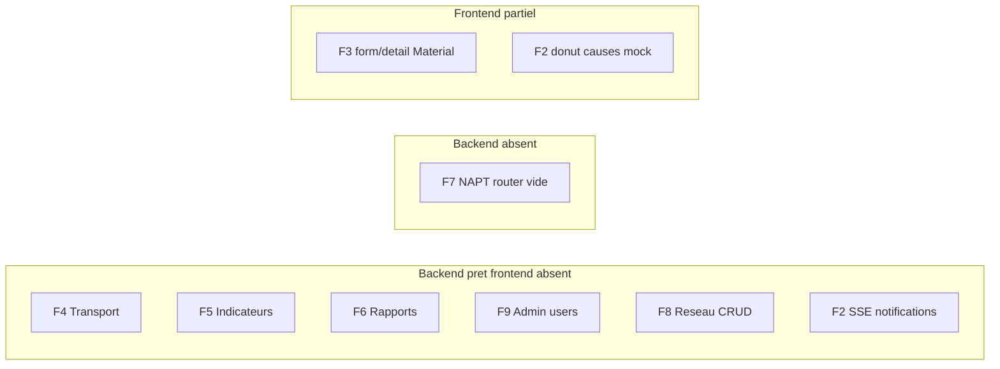
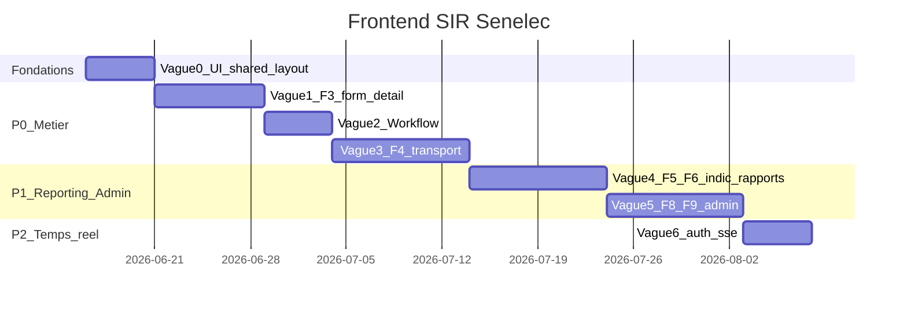

# Plan d'exécution frontend SIR Senelec

## État des lieux (15 juin 2026)

### Maquettes `docs/design/` → modules frontend

| Dossier design | Module BACKLOG | Backend API | Frontend |
|---|---|---|---|
| [connexion_sir_senelec](docs/design/connexion_sir_senelec/) | F1 Auth | `/auth/*` ✅ | ✅ UI refonte SCSS |
| [tableau_de_bord_sir_senelec](docs/design/tableau_de_bord_sir_senelec/) | F2 Dashboard | `/indicateurs/tableau-de-bord`, `/historique` ✅ | ✅ UI refonte + `DashboardService` |
| [liste_des_interruptions_sir_senelec](docs/design/liste_des_interruptions_sir_senelec/) | F3 Liste | `/interruptions/distribution` ✅ | ✅ UI refonte |
| [saisie_interruption_distribution_sir_senelec](docs/design/saisie_interruption_distribution_sir_senelec/) | F3 Création/édition | `POST`, `PUT` ✅ | ⚠️ Fonctionnel **Material** (pas maquette) |
| [details_de_l_interruption_sir_distribution_senelec](docs/design/details_de_l_interruption_sir_distribution_senelec/) | F3 Détail | `GET`, `PATCH cloturer/valider`, postes ✅ | ⚠️ Fonctionnel **Material** |
| [saisie_interruption_transport_sir_senelec](docs/design/saisie_interruption_transport_sir_senelec/) | F4 Transport | `/interruptions/transport` ✅ | ❌ |
| [details_de_l_interruption_sir_transport_senelec](docs/design/details_de_l_interruption_sir_transport_senelec/) | F4 Transport | idem ✅ | ❌ |
| [file_de_validation_sir_senelec_1](docs/design/file_de_validation_sir_senelec_1/) + [_2](docs/design/file_de_validation_sir_senelec_2/) | Workflow validation | Filtre `statut=cloture` + `PATCH valider` ✅ | ❌ (nav « Workflow » grisée) |
| [rapports_et_indicateurs_sir_senelec_1](docs/design/rapports_et_indicateurs_sir_senelec_1/) | F5 + F6 hub | `/indicateurs/*`, `/rapports/*` ✅ | ❌ |
| [rapports_et_indicateurs_sir_senelec_2](docs/design/rapports_et_indicateurs_sir_senelec_2/) | F5 détail graphiques | idem ✅ | ❌ |
| [administration_referentiels_sir_distribution_senelec](docs/design/administration_referentiels_sir_distribution_senelec/) | F8 Réseau dist. | `/referentiel`, `/reseau/feeders` ✅ | ⚠️ `/referentiel` minimal hors layout |
| [administration_referentiels_sir_transport_senelec](docs/design/administration_referentiels_sir_transport_senelec/) | F8 Réseau transp. | `/reseau/transport/*` ✅ | ❌ |
| [gestion_des_utilisateurs_sir_senelec_1](docs/design/gestion_des_utilisateurs_sir_senelec_1/) + [_2](docs/design/gestion_des_utilisateurs_sir_senelec_2/) | F9 Admin users | `/admin/utilisateurs` ✅ | ❌ |

### Déjà en place (socle)

- Layout shell : [`main-layout.component`](sir-frontend/src/app/shared/layout/main-layout/main-layout.component.ts) — sidebar 260px + topbar, routes enfants pour `/` et `/interruptions/distribution/*`
- Tokens design : [`_sir-tokens.scss`](sir-frontend/src/styles/_sir-tokens.scss) — primaire `#3d49a0` (logo)
- Auth core : `AuthService`, guards, intercepteur JWT
- Services métier existants : interruptions distribution, référentiel, geo, dashboard (indicateurs partiel)

### Écarts BACKLOG vs réalité code

Le [BACKLOG F2/F3](docs/BACKLOG.md) n'est pas à jour : dashboard et liste ont déjà KPI + graphiques + tableau API, mais **form/détail distribution** et **référentiel/geo** restent en Material hors shell.

### Backend sans frontend (priorité intégration)

---

## Principes transverses (toutes vagues)

### Conventions sir-frontend

- **Pas de Tailwind CDN** : traduire `code.html` → `.html` + `.scss` avec `@use 'styles/sir-tokens'`
- **Pas de HttpClient dans les composants** : un service par domaine, unwrap `ApiResponse<T>`
- **Interfaces TS** : lire d'abord `sir-backend/app/schemas/*.py` — snake_case conservé (convention actuelle du projet, cf. [INTEGRATION_REPORT_interruptions_distribution.md](docs/integration/INTEGRATION_REPORT_interruptions_distribution.md))
- **Reactive Forms** + `RoleGuard` / `*sirHasRole`
- **Lazy loading** sur chaque feature
- Réutiliser composants partagés à extraire en vague 0 : `PageHeader`, `FilterPanel`, `DataTable`, `StatusChip`, `Paginator`, `KpiCard`

### Extension du layout

Migrer **toutes** les routes authentifiées sous [`MainLayoutComponent`](sir-frontend/src/app/shared/layout/main-layout/main-layout.component.ts) dans [`app.routes.ts`](sir-frontend/src/app/app.routes.ts) — aujourd'hui `/referentiel` et `/geo` sont hors shell.

Activer progressivement la sidebar :

| Entrée nav | Route cible | Vague |
|---|---|---|
| Tableau de bord | `/` | ✅ |
| Interruptions | `/interruptions/distribution` | ✅ |
| Workflow | `/workflow/validation` | 2 |
| Rapports | `/rapports` ou `/indicateurs` | 4 |
| Administration | `/admin` | 5 |
| Utilisateurs | `/admin/utilisateurs` | 5 |

---

## Vague 0 — Fondations UI (1 sprint court, prérequis)

**Agent :** sir-frontend  
**Objectif :** éviter de dupliquer le SCSS des 3 pages déjà refondues sur les 10 restantes.

1. Créer `shared/ui/` : boutons, champs, badges statut, pagination (extraire patterns de [dashboard.component.scss](sir-frontend/src/app/features/dashboard/dashboard.component.scss) et [interruption-list.component.scss](sir-frontend/src/app/features/interruptions-distribution/interruption-list/interruption-list.component.scss))
2. Centraliser labels statut FR (`en_cours` → « En cours », etc.) dans `shared/utils/statut.utils.ts`
3. Compléter F0 core :
   - `ErrorInterceptor` (401 → login, 403 → page accès refusé)
   - Page « accès refusé » standalone
4. Refactor routes : tout sous `MainLayoutComponent` sauf `/login`

**Gate sir-integration (vague 0)**  
- Vérifier enveloppe `ApiResponse`, intercepteur auth, matrice RBAC guards vs seed — rapport `INTEGRATION_REPORT_core_frontend.md`

---

## Vague 1 — Finaliser F3 Distribution (priorité immédiate)

**Design :** saisie + détail distribution  
**Backend :** déjà validé ([INTEGRATION_REPORT_interruptions_distribution.md](docs/integration/INTEGRATION_REPORT_interruptions_distribution.md))

### 1.1 Formulaire saisie distribution

- Refondre [`interruption-form.component.ts`](sir-frontend/src/app/features/interruptions-distribution/interruption-form/interruption-form.component.ts) → `.html` / `.scss` selon [saisie_interruption_distribution_sir_senelec/code.html](docs/design/saisie_interruption_distribution_sir_senelec/code.html)
- Conserver Reactive Form + appels `InterruptionDistributionService.create()`
- Sections maquette : identification (feeder, dates), référentiels (cause, nature, siège, signalisation), puissance/END estimée, observations, checkboxes force majeure / programme
- Breadcrumb + boutons Enregistrer / Annuler

### 1.2 Vue détail distribution

- Refondre [`interruption-detail.component.ts`](sir-frontend/src/app/features/interruptions-distribution/interruption-detail/interruption-detail.component.ts) selon [details_de_l_interruption_sir_distribution_senelec/code.html](docs/design/details_de_l_interruption_sir_distribution_senelec/code.html)
- Conserver : timeline phases, postes impactés, clôture, validation RBAC
- Header : numéro `INT-{année}-{n°}`, badges statut, métriques END/durée/clients

### 1.3 Édition (manquant BACKLOG)

- Backend `PUT /interruptions/distribution/{id}` existe — ajouter `update()` au service + mode édition (route `/interruptions/distribution/:id/modifier` ou toggle sur détail si `statut === en_cours`)
- Rôles : BCC, ADMIN_SCR (alignés backend `update`)

### 1.4 Compléter liste (gaps vs API)

- Colonnes **cause** / **région** : aujourd'hui absentes du `InterruptionDistributionResponse` — **sir-integration** doit trancher :
  - **Option A (recommandée)** : enrichir le schéma backend liste (`cause_libelle`, `feeder_libelle`, `region_libelle`) — petit changement backend
  - **Option B** : afficher placeholders côté UI jusqu'à enrichissement API
- Export Excel/PDF bouton : désactivé jusqu'à endpoint dédié (hors scope backend actuel)

**Gate sir-integration (vague 1)**  
- Mettre à jour `INTEGRATION_REPORT_interruptions_distribution.md` (UI refonte + PUT edit)
- Tests manuels : scénarios BCC création → clôture → SUPERVISEUR validation
- Checklist RBAC boutons Voir/Modifier/Valider vs permissions backend

---

## Vague 2 — Workflow validation

**Design :** [file_de_validation_sir_senelec_1](docs/design/file_de_validation_sir_senelec_1/) (liste) + [_2](docs/design/file_de_validation_sir_senelec_2/) (détail split-pane)

- Nouvelle feature `features/workflow/validation-queue/`
- Route `/workflow/validation` — activer entrée sidebar « Workflow »
- Données : `GET /interruptions/distribution?statut=cloture` (+ filtres région/période)
- Actions bulk : validation unitaire via `PATCH …/valider` — pas de batch backend → UI séquentielle ou sélection sans action groupée
- Rôles : SUPERVISEUR, ADMIN_SCR, ADMIN_SAQS
- Maquette _2 : panneau détail à droite (réutiliser composant détail en mode embedded ou drawer)

**Gate sir-integration**  
- Rapport `INTEGRATION_REPORT_workflow_validation.md`

---

## Vague 3 — F4 Interruptions Transport (P0 BACKLOG)

**Design :** saisie + détail transport  
**Backend :** [`/interruptions/transport`](sir-backend/app/api/v1/interruptions/transport/router.py) ✅

1. **sir-integration** : lire `app/schemas/interruption_transport.py` → créer `interruption-transport.models.ts` + matrice RBAC (DISPATCHER, ADMIN_DISPATCHING, ADMIN_SAQS)
2. `InterruptionTransportService` (miroir distribution)
3. Routes sous layout :
   - `/interruptions/transport` (liste — réutiliser template liste avec colonnes HTB)
   - `/interruptions/transport/nouveau`
   - `/interruptions/transport/:id`
4. UI selon maquettes transport (champs spécifiques : postes HTB, lignes, etc. — lire `code.html` + schéma Pydantic)
5. Étendre nav « Interruptions » → sous-menu Distribution / Transport ou onglets

**Gate sir-integration**  
- Rapport `INTEGRATION_REPORT_interruptions_transport.md`

---

## Vague 4 — F5 Indicateurs + F6 Rapports (P1)

**Design :** [rapports_et_indicateurs_sir_senelec_1](docs/design/rapports_et_indicateurs_sir_senelec_1/) (hub) + [_2](docs/design/rapports_et_indicateurs_sir_senelec_2/) (graphiques détaillés)

### 4.1 Modèles + services

- Étendre [`indicateurs.models.ts`](sir-frontend/src/app/shared/models/indicateurs.models.ts) depuis `app/schemas/indicateurs.py`
- Créer `rapports.models.ts` depuis [INTEGRATION_REPORT_rapports.md](docs/integration/INTEGRATION_REPORT_rapports.md) (`RapportEnqueueResponse`, polling statut, download binaire)
- `IndicateursService` (END, SAIFI, SAIDI, historique, top-feeders)
- `RapportsService` (POST 202 → poll → download)

### 4.2 Pages

- `/indicateurs` — sélecteurs période/région/direction, cartes KPI, graphiques Chart.js ou barres CSS (comme dashboard), ligne objectif CRSE si dispo backend
- `/rapports` — déclenchement journalier/mensuel/annuel, suivi progression task, téléchargement PDF/XLSX
- Activer nav « Rapports »

### 4.3 Dashboard F2 — dette technique

- Remplacer donut « répartition par cause » (mock) par endpoint réel **si** sir-backend l'expose — sinon documenter comme limitation
- Brancher filtre « Derniers 30 jours » sur paramètre `periode` API

**Gate sir-integration**  
- Rapports `INTEGRATION_REPORT_indicateurs.md` + mise à jour `INTEGRATION_REPORT_rapports.md` (section frontend)

---

## Vague 5 — F8 Réseau + F9 Administration (P1)

**Design :** admin référentiels dist/transp + gestion utilisateurs (_1 liste KPI, _2 modal rôles)

### 5.1 Administration référentiels

- Refondre [`referentiel-list.component`](sir-frontend/src/app/features/referentiel/referentiel-list/referentiel-list.component.ts) selon maquettes distribution/transport
- CRUD complet via `/referentiel` (POST/PUT/DELETE déjà backend)
- Nouveau module `features/reseau/` : feeders, postes, tronçons — API [`/reseau/*`](sir-backend/app/api/v1/reseau/router.py)
- Routes : `/admin/referentiel`, `/admin/reseau/distribution`, `/admin/reseau/transport`

### 5.2 Gestion utilisateurs

- Feature `features/admin/utilisateurs/` selon [gestion_des_utilisateurs_sir_senelec_1/2](docs/design/gestion_des_utilisateurs_sir_senelec_1/)
- Service `AdminUtilisateurService` ↔ `/admin/utilisateurs`
- Modal création/édition, reset mot de passe, activation/désactivation
- Activer nav « Administration » + « Utilisateurs »

**Gate sir-integration**  
- Rapports `INTEGRATION_REPORT_admin.md`, `INTEGRATION_REPORT_reseau.md` (mise à jour geo/reseau existant)

---

## Vague 6 — F1 complément + F2 temps réel (P2)

**Design :** connexion (done) + notifications topbar

- Page changement mot de passe obligatoire (`premiere_connexion` dans `MeResponse`) — route guard post-login
- SSE notifications : backend `/notifications/stream?token=` ✅ — service EventSource + badge topbar dans [`main-layout`](sir-frontend/src/app/shared/layout/main-layout/main-layout.component.html)
- Toast dashboard : nouvelles interruptions / rapports prêts (TODO Sprint 8 frontend reporté)

**Gate sir-integration**  
- `INTEGRATION_REPORT_notifications.md`

---

## Reporté / hors scope immédiat

| Item | Raison |
|---|---|
| **F7 NAPT** | [`napt/router.py`](sir-backend/app/api/v1/napt/router.py) vide — attendre backend |
| **NgRx store global** | BACKLOG F0 — optionnel tant que signals + services suffisent |
| **Export Excel liste interruptions** | Pas d'endpoint backend liste export |
| **Module geo `/geo`** | Outil dev/debug — migrer sous admin ou retirer de prod |

---

## Rôle sir-integration — checkpoints obligatoires

Après **chaque vague**, sir-integration exécute :

1. **Schémas** : comparer Pydantic ↔ interfaces TS champ par champ (types, nullabilité, noms snake_case)
2. **Endpoints** : méthode HTTP, path, query params (`page_size` vs `size`), body, codes 202/204/download binaire
3. **RBAC** : matrice rôle UI (`RoleGuard`, `*sirHasRole`) vs `require_permission` backend
4. **Enveloppe** : tous les services unwrap `ApiResponse` + gestion erreur métier
5. **Dates** : ISO 8601, timezone, `datetime-local` → payload API
6. **Livrable** : `docs/integration/INTEGRATION_REPORT_{module}.md` avec statut **VALIDÉ / NON VALIDÉ** et corrections assignées

Rapports existants à maintenir :

- ✅ [interruptions_distribution](docs/integration/INTEGRATION_REPORT_interruptions_distribution.md)
- ✅ [referentiel](docs/integration/INTEGRATION_REPORT_referentiel.md)
- ✅ [geo_reseau](docs/integration/INTEGRATION_REPORT_geo_reseau.md)
- ⚠️ [rapports](docs/integration/INTEGRATION_REPORT_rapports.md) — backend only, section frontend à compléter vague 4

---

## Ordre d'exécution recommandé (timeline)

**Prochaine action concrète :** Vague 0 (composants partagés + routes layout) puis Vague 1.1 refonte formulaire saisie distribution — c'est le gap le plus visible après login/dashboard/liste.

---

## Mise à jour documentation (fin de chaque vague)

- sir-qa : scénarios UI manuels + tests composants si ajoutés
- sir-orchestrateur : synchroniser [docs/BACKLOG.md](docs/BACKLOG.md) sections F0–F9 avec l'état réel (F2/F3 partiellement cochés, layout sidebar done)
- Ne cocher TODO/BACKLOG qu'après gate integration **VALIDÉ**
