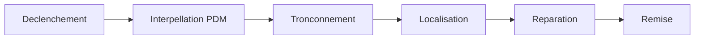

# Guide utilisateur — Interruptions distribution

**Public :** agents BCC et BRC.
**Application :** SIR (Système d'Information Réseau), SENELEC.

Ce guide explique comment enregistrer une interruption moyenne tension / basse tension, la faire avancer étape par étape, indiquer les postes touchés, puis la clôturer.

Ouvrez SIR à l'adresse communiquée par votre administrateur. En recette, l'adresse est `http://localhost:4210`.

---

## 1. À quoi sert SIR pour vous

Une interruption distribution se suit sur une seule fiche :

1. Vous la créez (date d'apparition, réseau, cause).
2. Vous notez le déroulement : déclenchement, interpellation, tronçonnement, localisation, réparation, remise.
3. Vous cochez les postes touchés.
4. Vous la clôturez avec la date de remise.

Tant que le statut est **En cours**, vous pouvez modifier la fiche. Après clôture, elle n'est plus modifiable. Un superviseur ou un administrateur SCR la valide ensuite. Le BCC et le BRC ne valident pas.

---

## 2. Connexion

1. Ouvrez l'adresse SIR.
2. Saisissez votre **Identifiant** et votre **Mot de passe**.
3. Cliquez sur **Connexion**.

À la première connexion, SIR demande de changer le mot de passe avant d'entrer dans l'application. Choisissez un nouveau mot de passe, confirmez-le, puis reconnectez-vous.

Pour quitter : en bas du menu de gauche, cliquez sur votre nom. La session se ferme et l'écran de connexion réapparaît.

Si l'identifiant ou le mot de passe est refusé, le message « Identifiants invalides » s'affiche. Vérifiez la saisie ou demandez une réinitialisation à votre administrateur.

---

## 3. Ce que vous voyez

Après connexion, le menu de gauche propose notamment :

| Entrée | Usage pour le BCC / BRC |
|---|---|
| **Tableau de bord** | Vue d'accueil |
| **Interruptions** | Liste et saisie des interruptions distribution |

Votre périmètre est limité :

- **BCC** — vous voyez et saisissez les interruptions de votre service. La région est verrouillée.
- **BRC** — vous voyez et saisissez les interruptions de votre région. La région est verrouillée.

Les deux rôles peuvent créer et modifier une fiche **En cours**. Une fiche d'un autre service (BCC) ou d'une autre région (BRC) n'est pas accessible : l'écran **Accès refusé** s'affiche.

---

## 4. Liste des interruptions

Menu **Interruptions**. Le titre de l'écran est **Liste des interruptions**.

### Filtres

| Filtre | Rôle |
|---|---|
| **Période (début)** et **Période (fin)** | Restreint les fiches à une plage de dates |
| **Région** | Verrouillée sur votre périmètre (BCC ou BRC) |
| **Service** | Visible dans le périmètre régional ; « Tous les services » ou un service précis |
| **Feeder** | Un départ, ou « Tous les feeders » |
| **Nature** | Type de défaut (permanent, fugitif, etc.), ou « Toutes les natures » |
| **Ouverture** | **Toutes**, **Ouvertes** ou **Fermées** |

Cliquez sur **Filtrer** pour appliquer. **Réinitialiser** efface les filtres. Chaque filtre actif apparaît sous forme de pastille : la croix retire ce filtre seul.

Le bouton **Exporter Excel/PDF** est affiché mais n'est pas encore disponible.

### Lire une ligne

La liste indique le numéro, le service, la date, la source, la tension, le feeder et le statut (**En cours**, **Clôturée**, **Validée**).

- Cliquez sur une ligne pour ouvrir la fiche.
- Le bouton **Nouvelle saisie** ouvre le formulaire de création.
- Sur une fiche **En cours**, l'action de modification est proposée dans la liste.

Un badge indique le nombre de fiches **non validées** dans le périmètre filtré.

---

## 5. Nouvelle saisie

**Nouvelle saisie** ouvre **Formulaire de saisie d'interruption**.

Le bouton **Soumettre** reste inactif tant que les champs obligatoires ne sont pas remplis. **Annuler** revient à la liste sans enregistrer.

### Identification réseau

Renseignez dans cet ordre. Chaque liste ne propose que ce qui dépend du choix précédent.

1. **Région** — déjà fixée sur votre périmètre.
2. **Poste source**
3. **Feeder** — le **Service** se remplit tout seul à partir du feeder. Il n'est pas saisissable.
4. **Sous-feeder** — obligatoire.
5. **Localisation** — texte libre (lieu ou tronçon décrit en toutes lettres). Facultatif.

S'il n'existe qu'un seul poste source, un seul feeder ou un seul sous-feeder, SIR le sélectionne.

### Chronologie et caractérisation

| Champ | Obligatoire | Remarque |
|---|---|---|
| **Apparition** | Oui | Date et heure de début de l'incident |
| **Cause**, **Nature**, **Siège**, **Signalisation** | Oui | Choisissez une valeur dans chaque liste |
| **Entreprise** | Non | « Aucune » si elle n'intervient pas |
| **Prestataire** | Non | « Aucun » si aucun prestataire. Indépendant de l'entreprise |

Si **Entreprise** ou **Prestataire** ne propose rien d'autre que « Aucune » / « Aucun », les listes n'ont pas encore été alimentées. Un administrateur SCR les crée dans **Administration**, onglets Entreprises et Prestataires. Vous pouvez soumettre la fiche sans ces deux informations.

### Impact

| Champ | Remarque |
|---|---|
| **Puissance coupée (MW)** | Facultatif |
| **Tension (kV)** | Facultatif |
| **Clients MT** / **Clients BT** | Facultatif, effectifs globaux |
| **Force majeure** | À cocher si le cas s'applique |
| **Fugitive** | À cocher pour un défaut fugitif |
| **Extension BT** | À cocher si le défaut BT est lié au MT |

Le bloc **Observations** sert au commentaire libre.

Cliquez sur **Soumettre**. SIR ouvre la fiche détail. Le statut initial est **En cours**.

---

## 6. Fiche et workflow

La fiche résume le réseau, la chronologie, la caractérisation, l'entreprise, le prestataire et les observations.

Le bloc **Workflow opérationnel** se remplit après la création. Six étapes se suivent. L'onglet **Clients** n'est pas une étape : il reprend les postes cochés.

### Règle d'affichage

- L'étape en cours est la première qui n'a pas de **date de fin**.
- Les étapes suivantes restent masquées. Un cadenas indique « N étape(s) à venir ».
- Saisissez la **date de fin** de l'étape affichée, puis **Enregistrer**. L'étape suivante apparaît.
- Une étape déjà terminée reste visible : vous pouvez la relire.
- La date de fin doit être postérieure à la date de début de la même étape.

Vous ne pouvez pas sauter une étape. Si vous tentez d'enregistrer une étape encore verrouillée, SIR refuse avec le message : « L'étape précédente doit avoir une date de fin avant de saisir cette étape ».

### Contenu de chaque étape

| Étape | Ce que vous saisissez |
|---|---|
| **Déclenchement** | Début, fin, matricule responsable, observation |
| **Interpellation PDM** | Début, fin, matricule, observation |
| **Tronçonnement** | Début, fin, **Tronçon SIG**, nœud amont, nœud aval, matricule, observation |
| **Localisation** | Début, fin, matricule, observation |
| **Réparation** | Début, fin, matricule, observation |
| **Remise** | Début, fin, matricule, observation |

Sur **Tronçonnement** :

- La liste **Tronçon SIG** ne se charge que si la fiche a un feeder. Sinon le message « Feeder non renseigné — liste Troncon_SIG indisponible » s'affiche.
- **Topologie SIG** ouvre le choix du tronçon sur la carte du feeder.
- Le tronçon, le nœud amont et le nœud aval ne sont enregistrés que sur cette étape.

Le workflow n'est modifiable que tant que l'interruption est **En cours**.

---

## 7. Postes impactés

Ouvrez l'onglet **Clients** du workflow. La liste propose les postes du feeder. Cochez ceux qui ont été touchés. Décochez pour retirer un poste.

- Le nombre de clients du poste est affiché à côté du libellé.
- La date d'interruption du poste reprend la date d'apparition de la fiche.
- **Tout cocher (feeder)** ajoute tous les postes du feeder qui ne sont pas déjà cochés.
- **Postes du tronçon SIG** n'est actif que si un tronçon SIG a été choisi à l'étape Tronçonnement. Il coche les postes rattachés à ce tronçon. Sans tronçon, le bouton indique « Sélectionnez un tronçon SIG dans l'onglet Tronçonnement ».
- La zone **Rechercher un poste** filtre par code ou par libellé.

Le compteur « N poste(s) impacté(s) » résume la sélection. Ces postes alimentent l'onglet Clients (nombre de postes et total de clients touchés).

---

## 8. Clôturer

Sur une fiche **En cours**, le bloc **Clôturer l'interruption** demande la **Date de remise**.

La durée est la différence entre cette date et la date d'apparition.

| Durée | Postes impactés |
|---|---|
| **5 minutes ou moins** | Aucun poste n'est exigé. Vous pouvez clôturer. |
| **Plus de 5 minutes** | Au moins un poste doit être coché avant **Clôturer**. |

Si la durée dépasse 5 minutes et qu'aucun poste n'est coché, SIR affiche : « Pour une interruption de plus de 5 minutes, au moins un poste impacté doit être coché. » Un rappel du même ordre est visible sous le bouton tant qu'aucun poste n'est sélectionné.

La date de remise doit être **après** la date d'apparition. Sinon : « La date de remise doit être postérieure à la date d'apparition. »

Après une clôture réussie, le statut passe à **Clôturée**. Le workflow, les postes et le formulaire ne sont plus modifiables. La validation est faite ensuite par un superviseur ou un administrateur SCR, depuis leur file de validation. Vous n'avez pas cette action.

---

## 9. Modifier une fiche en cours

Depuis la fiche ou la liste, **Modifier** ouvre le même formulaire, avec le titre **Modifier l'interruption**.

- **Poste source**, **Feeder** et **Sous-feeder** sont figés. Pour changer le réseau, il faut créer une autre fiche.
- Vous pouvez corriger la date d'apparition, la cause, la nature, le siège, la signalisation, l'entreprise, le prestataire, les cases à cocher et les observations.
- **Enregistrer** confirme. Le message « Modifications enregistrées » s'affiche, et le workflow reste accessible sous le formulaire.

Dans la fiche, le bloc **Historique** indique **Modifiée par** avec le nom de la dernière personne qui a enregistré, clôturé ou fait avancer la fiche.

Une fiche déjà clôturée ou validée ne se modifie pas. Le formulaire affiche : « Seules les interruptions en cours peuvent être modifiées. »

---

## 10. En cas de blocage

| Ce que vous voyez | Que faire |
|---|---|
| **Accès refusé** | La fiche est hors de votre service (BCC) ou de votre région (BRC), ou l'action n'est pas prévue pour votre rôle. |
| **Identifiants invalides** | Vérifiez l'identifiant et le mot de passe, ou faites réinitialiser le compte. |
| Bouton **Soumettre** inactif | Il manque la date d'apparition, le poste source, le feeder, le sous-feeder, la cause, la nature, le siège ou la signalisation. |
| Étape suivante invisible, cadenas « étape(s) à venir » | Saisissez la date de fin de l'étape affichée, puis **Enregistrer**. |
| « L'étape précédente doit avoir une date de fin… » | Revenez à l'étape active et terminez-la avant celle-ci. |
| **Postes du tronçon SIG** grisé | Choisissez un tronçon à l'étape **Tronçonnement**. |
| « Pour une interruption de plus de 5 minutes… » | Cochez au moins un poste dans l'onglet **Clients**, puis recliquez sur **Clôturer**. |
| « La date de remise doit être postérieure… » | Corrigez la date de remise : elle doit être après l'apparition. |
| Listes **Entreprise** / **Prestataire** vides | Normal si personne ne les a encore créées. Laissez « Aucune » / « Aucun », ou demandez à un administrateur SCR de les renseigner. |
| « Seules les interruptions en cours peuvent être modifiées. » | La fiche est clôturée ou validée. Créez une nouvelle saisie si un autre incident doit être ouvert. |

---

*Guide SIR — interruptions distribution — BCC et BRC. Octobre 2026.*
