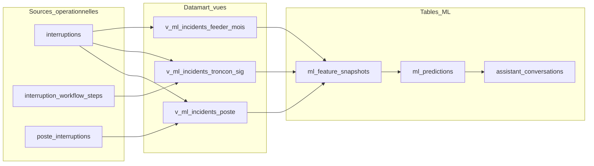
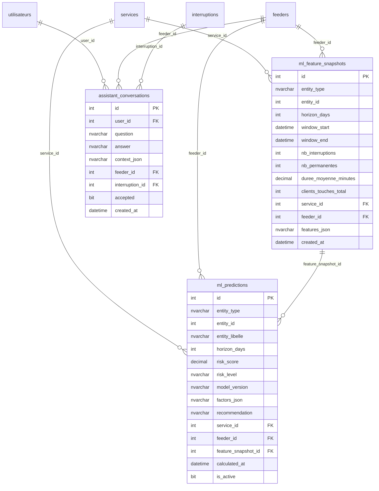
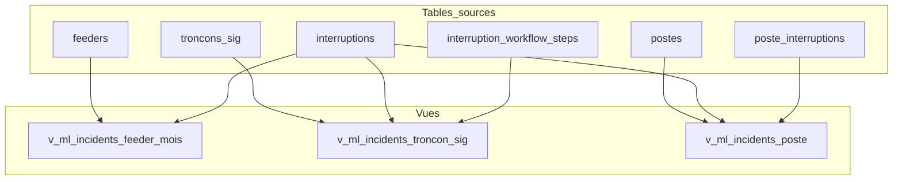
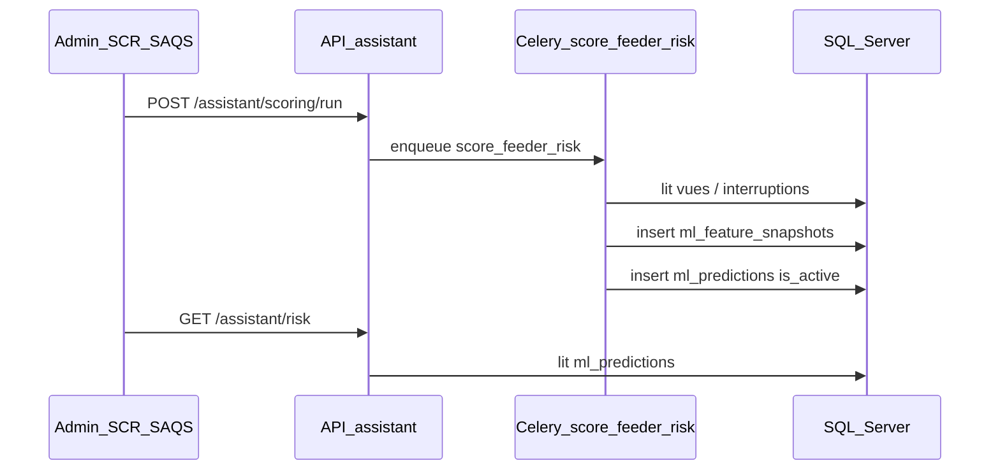

# Modèle relationnel — Assistant ML

**Système d’Information Réseau — SENELEC / SIRV2**

| | |
|---|---|
| **Objet** | Schéma des tables et vues du module Assistant ML (aide à la décision) |
| **Public** | SAQS, ADMIN_SCR, équipe technique SIR |
| **Version** | 1.0 — P0 (règles + statistiques) — Septembre 2026 |
| **Périmètre** | Distribution MT/BT — module **satellite** (conseil, hors clôture / validation) |
| **Référence technique** | Migration `b2c3d4e5f6a7` · modèles `sir-backend/app/models/assistant_ml.py` |

---

## 1. Objet du document

Ce document décrit le **modèle relationnel** du module Assistant ML : tables persistées, vues datamart lecture seule, clés étrangères et flux de données.

Il sert à présenter le schéma en réunion (SAQS / métier / technique).  
Pour le contexte fonctionnel et les phases P1–P3, voir [`ASSISTANT_ML.md`](ASSISTANT_ML.md).  
Pour le modèle métier global SIRV2, voir [`MODELE_DONNEES_SIRV2.md`](MODELE_DONNEES_SIRV2.md).

**Principe** : le module ne modifie pas le chemin critique interruptions (saisie, clôture, validation). Il lit les données opérationnelles et produit des scores / suggestions.

---

## 2. Glossaire

| Terme | Définition |
|---|---|
| **Datamart** | Vues SQL agrégées en lecture seule sur les incidents (feeder, tronçon SIG, poste) |
| **Feature snapshot** | Instantané de indicateurs calculés sur une fenêtre temporelle (`ml_feature_snapshots`) |
| **Prédiction / score** | Score de risque 0–100 et niveau (`low` / `medium` / `high` / `critical`) stockés dans `ml_predictions` |
| **entity_type / entity_id** | Cible polymorphe du scoring : `feeder`, `troncon_sig` ou `poste` (pas de FK stricte sur l’entité) |
| **horizon_days** | Fenêtre d’analyse (défaut P0 : 90 jours) |
| **Conversation** | Échange Q/R audité (`assistant_conversations`) — suggestion, pas décision métier |

---

## 3. Vue d’ensemble

| Couche | Objets | Rôle |
|---|---|---|
| Sources | `interruptions`, `interruption_workflow_steps`, `poste_interruptions` (+ `feeders`, `postes`, `troncons_sig`) | Données métier existantes |
| Datamart | `v_ml_incidents_*` | Agrégats lecture seule |
| ML | `ml_feature_snapshots`, `ml_predictions` | Features + scores |
| Audit | `assistant_conversations` | Traçabilité Q/R et feedback |

---

## 4. Diagramme entité-relation

---

## 5. Tables

### 5.1 `ml_feature_snapshots`

Snapshot de features agrégées pour une entité et une fenêtre temporelle.

| Colonne | Type | Nullable | Description |
|---|---|---|---|
| `id` | INT | Non | Clé primaire |
| `entity_type` | NVARCHAR(20) | Non | `feeder` / `troncon_sig` / `poste` |
| `entity_id` | INT | Non | Identifiant de l’entité (polymorphe) |
| `horizon_days` | INT | Non | Horizon d’analyse (ex. 90) |
| `window_start` | DATETIME2 | Non | Début de fenêtre |
| `window_end` | DATETIME2 | Non | Fin de fenêtre |
| `nb_interruptions` | INT | Non | Nombre d’interruptions dans la fenêtre |
| `nb_permanentes` | INT | Non | Part « permanentes » (règles natures P0) |
| `duree_moyenne_minutes` | DECIMAL(18,4) | Oui | Durée moyenne |
| `clients_touches_total` | INT | Non | Somme clients touchés |
| `service_id` | INT | Oui | FK → `services.id` |
| `feeder_id` | INT | Oui | FK → `feeders.id` |
| `features_json` | NVARCHAR(4000) | Oui | Détail features (JSON texte) |
| `created_at` | DATETIME2 | Non | Horodatage création |

**Contrainte unique** : `(entity_type, entity_id, horizon_days, window_end)` — `uq_ml_feature_snapshot_entity_window`.

### 5.2 `ml_predictions`

Score de risque calculé (P0 = règles ; P1+ = modèles supervisés).

| Colonne | Type | Nullable | Description |
|---|---|---|---|
| `id` | INT | Non | Clé primaire |
| `entity_type` | NVARCHAR(20) | Non | Type d’entité scorée |
| `entity_id` | INT | Non | Identifiant entité |
| `entity_libelle` | NVARCHAR(255) | Oui | Libellé affiché |
| `horizon_days` | INT | Non | Horizon (ex. 90) |
| `risk_score` | DECIMAL(8,4) | Non | Score 0–100 |
| `risk_level` | NVARCHAR(20) | Non | `low` / `medium` / `high` / `critical` |
| `model_version` | NVARCHAR(50) | Non | Ex. `p0-rules-v1` |
| `factors_json` | NVARCHAR(4000) | Oui | Facteurs explicatifs |
| `recommendation` | NVARCHAR(1000) | Oui | Recommandation textuelle |
| `service_id` | INT | Oui | FK → `services.id` |
| `feeder_id` | INT | Oui | FK → `feeders.id` |
| `feature_snapshot_id` | INT | Oui | FK → `ml_feature_snapshots.id` |
| `calculated_at` | DATETIME2 | Non | Date du calcul |
| `is_active` | BIT | Non | Dernière prédiction active pour l’entité |

### 5.3 `assistant_conversations`

Audit des échanges Assistant (suggestions uniquement).

| Colonne | Type | Nullable | Description |
|---|---|---|---|
| `id` | INT | Non | Clé primaire |
| `user_id` | INT | Non | FK → `utilisateurs.id` |
| `question` | NVARCHAR(2000) | Non | Question utilisateur |
| `answer` | NVARCHAR(4000) | Non | Réponse Assistant |
| `context_json` | NVARCHAR(2000) | Oui | Contexte (feeder, filtres…) |
| `feeder_id` | INT | Oui | FK → `feeders.id` |
| `interruption_id` | INT | Oui | FK → `interruptions.id` |
| `accepted` | BIT | Oui | Feedback utile / non utile |
| `created_at` | DATETIME2 | Non | Horodatage |

---

## 6. Clés étrangères (synthèse)

| Table | Colonne | Référence |
|---|---|---|
| `ml_feature_snapshots` | `service_id` | `services.id` |
| `ml_feature_snapshots` | `feeder_id` | `feeders.id` |
| `ml_predictions` | `service_id` | `services.id` |
| `ml_predictions` | `feeder_id` | `feeders.id` |
| `ml_predictions` | `feature_snapshot_id` | `ml_feature_snapshots.id` |
| `assistant_conversations` | `user_id` | `utilisateurs.id` |
| `assistant_conversations` | `feeder_id` | `feeders.id` |
| `assistant_conversations` | `interruption_id` | `interruptions.id` |

**Note** : `entity_id` n’a pas de FK vers `feeders` / `troncons_sig` / `postes` — l’entité est polymorphe ; le rattachement métier opérationnel passe surtout par `feeder_id` et `service_id`.

---

## 7. Vues datamart (lecture seule)

### 7.1 `v_ml_incidents_feeder_mois`

| | |
|---|---|
| **Grain** | Feeder × année × mois |
| **Sources** | `interruptions` LEFT JOIN `feeders` |
| **Filtre** | `type_direction = distribution` et `feeder_id` renseigné |
| **Mesures** | `nb_interruptions`, `nb_force_majeure`, `duree_moyenne_minutes`, `clients_touches_total` |

### 7.2 `v_ml_incidents_troncon_sig`

| | |
|---|---|
| **Grain** | Tronçon SIG (+ feeder / service) |
| **Sources** | `interruption_workflow_steps` INNER JOIN `interruptions` LEFT JOIN `troncons_sig` |
| **Filtre** | Distribution + `troncon_sig_id` renseigné |
| **Mesures** | `nb_interruptions`, `duree_moyenne_minutes`, `derniere_apparition` |

### 7.3 `v_ml_incidents_poste`

| | |
|---|---|
| **Grain** | Poste impacté |
| **Sources** | `poste_interruptions` INNER JOIN `interruptions` LEFT JOIN `postes` |
| **Filtre** | Distribution |
| **Mesures** | `nb_impactes`, `clients_touches_total`, `derniere_apparition` |
| **Feeder / service** | `COALESCE(pi.feeder_id, p.feeder_id)` / `COALESCE(pi.service_id, p.service_id)` |

---

## 8. Flux de calcul (P0)

1. Agrégation sur horizon (défaut 90 j) à partir des incidents distribution.  
2. Écriture d’un snapshot dans `ml_feature_snapshots`.  
3. Calcul du score P0 (fréquence, permanentes, durée, clients) → `ml_predictions`.  
4. Affichage UI `/assistant` et panneau fiche interruption ; chat audité dans `assistant_conversations`.

---

## 9. Périmètre et hors périmètre

**Inclus (P0)** : tables ci-dessus, vues datamart, scoring règles, audit conversations.

**Hors schéma actuel (P1–P3)** : tables de modèles entraînés, features spatio-temporelles SIG avancées, stockage embeddings / RAG LLM — à ajouter après validation SAQS.

---

## 10. Présentation

**Version avec diagrammes** : ouvrir [`MODELE_ASSISTANT_ML.html`](MODELE_ASSISTANT_ML.html) dans Chrome ou Edge.  
Pour un PDF : Ctrl+P → « Enregistrer au format PDF ».

Document lié : [`ASSISTANT_ML.md`](ASSISTANT_ML.md) (phases, API, RBAC) · [`MODELE_DONNEES_SIRV2.md`](MODELE_DONNEES_SIRV2.md) (modèle métier global).

---

*Document de présentation — SIRV2 / SENELEC — Assistant ML P0 — Septembre 2026*
