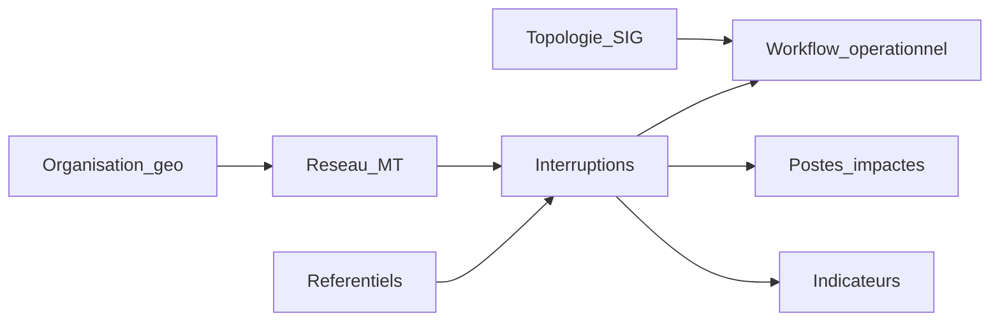
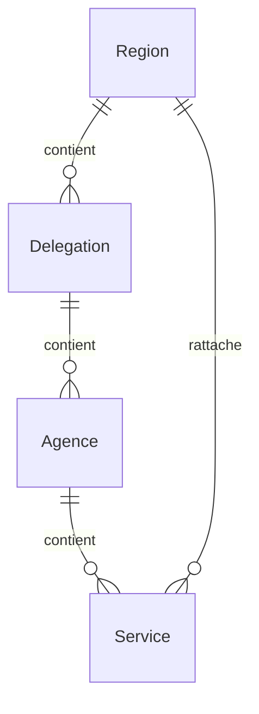
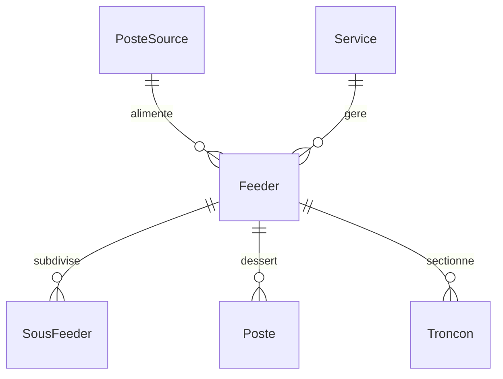
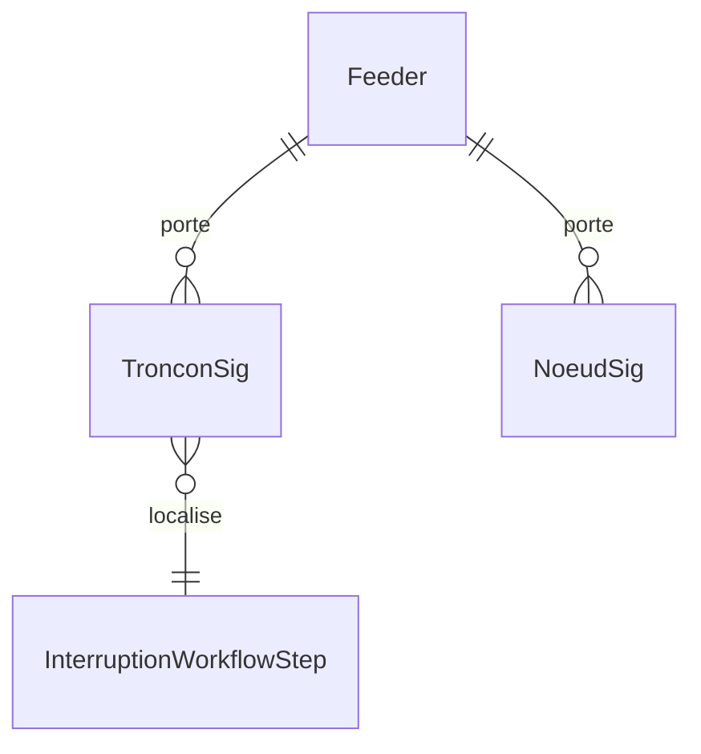
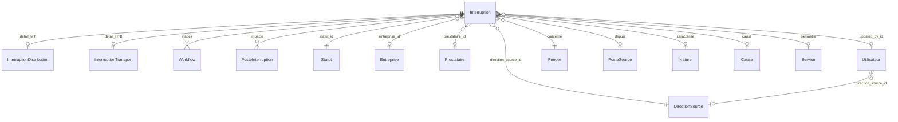
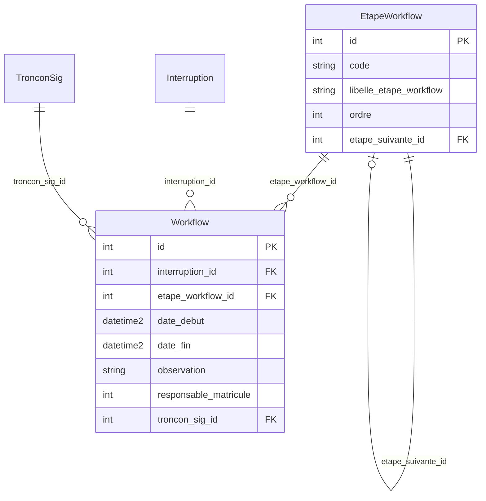
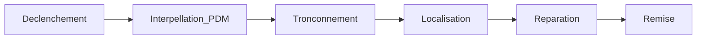
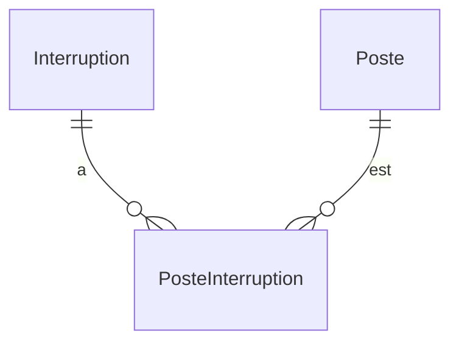
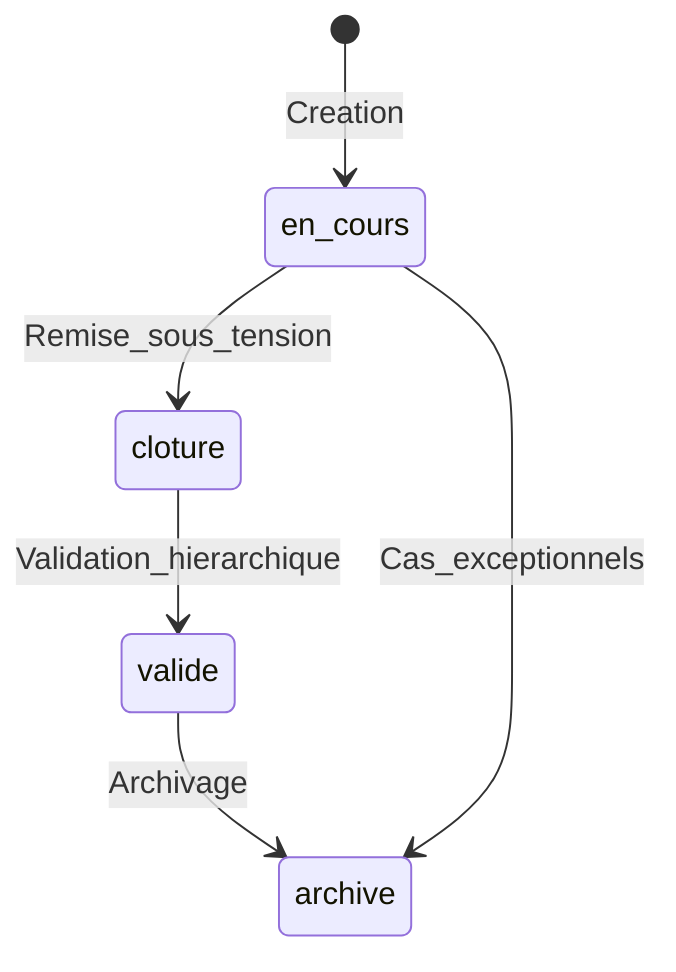
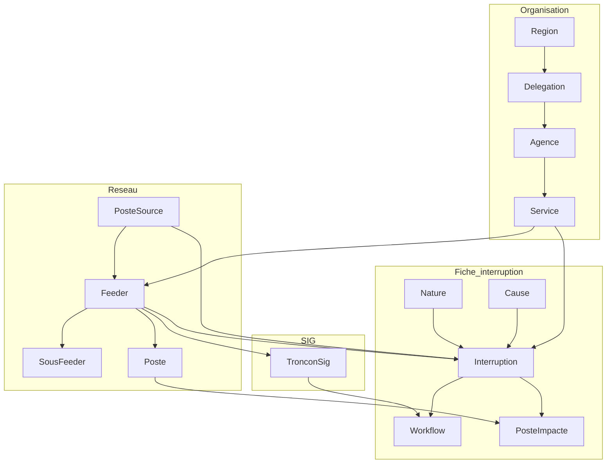

# Modèle de données SIRV2

**Système d’Information Réseau — SENELEC**

| | |
|---|---|
| **Objet** | Description du modèle de données métier SIRV2 |
| **Public** | Fonctionnels métier, chef de service, SAQS |
| **Version** | 1.0 — Juillet 2026 |
| **Périmètre** | Distribution (MT/BT) en détail ; aperçu Transport / OMVG |
| **Source** | Schéma cible SIRV2 (migration depuis SIR HFSQL / WebDev) |

---

## 1. Objet du document

Ce document décrit **comment les informations métier sont organisées** dans SIRV2 : interruptions, réseau, topologie SIG, postes impactés, indicateurs et rôles.

Il sert à :

- partager une vision commune entre métier et technique ;
- valider les concepts (départ, tronçonnement, nature, postes impactés…) ;
- faciliter la reprise des données depuis l’existant HFSQL.

Ce n’est **pas** une documentation technique d’API ni un manuel utilisateur.

---

## 2. Glossaire métier

| Terme | Définition |
|---|---|
| **Interruption** | Coupure ou défaut sur le réseau, enregistrée avec un numéro, des dates, une nature et un rattachement géographique / réseau |
| **Direction** | Domaine de l’interruption : *distribution* (MT/BT), *transport* (HTB) ou *OMVG* |
| **Poste source** | Poste de transformation HTB/MT — point d’injection des départs MT |
| **Feeder (départ)** | Départ MT depuis un poste source |
| **Sous-feeder** | Subdivision d’un départ MT |
| **Poste** | Poste de transformation MT/BT (clients raccordés) |
| **Tronçon (référentiel)** | Section de ligne du référentiel historique HFSQL *Troncon* — **peu utiliséé** en opérationnel (~80 lignes) |
| **Tronçon SIG** | Segment de ligne issu de la topologie SIG (*Troncon_SIG*) — **référence pour le tronçonnement** |
| **Nœud SIG** | Point de la topologie (poste, piquage…) — amont / aval d’un tronçon SIG |
| **Nature** | Classification du défaut : permanent, semi-permanent, fugitif, délestage, coupure travaux… |
| **Cause / Siège / Signalisation** | Référentiels de caractérisation de l’incident |
| **Localisation** | Texte libre décrivant le lieu (souvent héritage de *NomTroncon* HFSQL) |
| **Workflow opérationnel** | Suivi des étapes terrain : déclenchement, interpellation PDM, tronçonnement, localisation, réparation, remise, clients |
| **Poste impacté** | Poste MT/BT touché par l’interruption, avec nombre de clients concernés |
| **END** | Énergie Non Distribuée (MWh) |
| **SAIFI / SAIDI** | Indicateurs de fréquence et durée moyenne d’interruption par client |
| **BCC** | Bureau de Conduite Central — saisie distribution sur son périmètre |
| **BRC** | Bureau Régional de Conduite — lecture / suivi régional |
| **ADMIN_SCR** | Administration SCR — validation distribution nationale |
| **ADMIN_SAQS** | SAQS — lecture nationale et validation indicateurs / rapports |

---

## 3. Vue d’ensemble des domaines

| Domaine | Rôle métier |
|---|---|
| Organisation | Régions, délégations, agences, services — périmètre de responsabilité |
| Réseau MT | Postes sources, départs, sous-feeders, postes clients |
| Topologie SIG | Tronçons et nœuds pour localiser le défaut sur le réseau |
| Référentiels | Natures, causes, sièges, signalisations |
| Interruptions | Fiche centrale de l’incident |
| Workflow | Chronologie opérationnelle et tronçonnement SIG |
| Postes impactés | Clients touchés (base SAIFI/SAIDI) |
| Indicateurs | END, SAIFI, SAIDI, base clients mensuelle |

---

## 4. Organisation géographique

| Entité | Description métier | Attributs clés |
|---|---|---|
| **Région** | Découpage régional SENELEC | Code, libellé |
| **Délégation** | Sous-ensemble d’une région | Code, libellé, région |
| **Agence** | Agence opérationnelle | Code, libellé, délégation |
| **Service** | Unité de gestion (ex. SDDV, service régional) | Code, libellé, agence, région |

Les **rôles BCC / BRC** s’appuient sur ce découpage pour limiter la lecture et la saisie au bon périmètre.

---

## 5. Réseau distribution (MT/BT)

| Entité | Description métier | Attributs clés |
|---|---|---|
| **Poste source** | Injection HTB → MT | Code, libellé, région, puissance (MVA) |
| **Feeder (départ)** | Départ MT | Code, libellé, tension (kV), poste source, service |
| **Sous-feeder** | Subdivision du départ | Code, libellé, feeder |
| **Poste** | Poste MT/BT (clients) | Code, libellé, puissance (kVA), nombre de clients, feeder |
| **Tronçon** | Section référentiel historique | Code, libellé, longueur, feeder |

**Point d’attention métier** : le référentiel *Troncon* (table HFSQL `Troncon`) est **très incomplet**. Pour le tronçonnement opérationnel, SIRV2 s’appuie sur la **topologie SIG** (chapitre suivant).

Cascade de saisie d’une interruption distribution :

**Région → Poste source → Feeder → Sous-feeder (optionnel)**

---

## 6. Topologie SIG (tronçonnement)

Source : tables HFSQL **`Troncon_SIG`** et **`Noeud_SIG`** (serveur `srv-hfsql`), importées dans SIRV2.

| Entité | Description métier | Attributs clés |
|---|---|---|
| **Tronçon SIG** | Segment de ligne entre deux nœuds | Nom du tronçon, feeder, nœud amont, nœud aval, tension, longueur |
| **Nœud SIG** | Point du réseau (poste, piquage…) | Nom, feeder, catégorie, coordonnées |

### Règle métier — tronçonnement

1. L’opérateur sélectionne un **tronçon SIG** lié au **feeder** de l’interruption.
2. Les nœuds **amont** et **aval** sont renseignés automatiquement (ou ajustés).
3. À partir du tronçon SIG, on peut proposer les **postes impactés** sur la chaîne aval.

Dans l’existant HFSQL, le champ *NomTroncon* de l’interruption est souvent un **texte libre** (ex. `POSTE A - SECTION B`), sans lien systématique vers `ID_Troncon_SIG`. SIRV2 conserve ce texte en *localisation* et privilégie le lien explicite vers le tronçon SIG pour les nouvelles saisies.

---

## 7. Référentiels de caractérisation

| Entité | Usage | Particularité |
|---|---|---|
| **Nature** | Type de défaut / événement | Permanent, semi-permanent, fugitif, délestage, coupure… |
| **Cause** | Cause technique ou organisationnelle | Filtrable distribution / transport / commun |
| **Siège** | Localisation typologique du défaut | Idem |
| **Signalisation** | Mode de détection / signalisation | Idem |
| **Type END** | Classification pour l’énergie non distribuée | Référentiel END |
| **Statut** (*statuts*) | Cycle de vie de l’interruption | Figé : en_cours (1), cloture (2), valide (3), archive (4) — lecture seule |
| **Direction source** (*direction_sources*) | Domaine de l’interruption et de l’utilisateur | Figé : distribution (1), transport (2), omvg (3) — lecture seule |
| **Entreprise** (*entreprises*) | Entreprise intervenante sur l’incident | Optionnelle, gérée par ADMIN_SCR |
| **Prestataire** (*prestataires*) | Prestataire intervenant sur l’incident | Optionnel, indépendant de l’entreprise, géré par ADMIN_SCR |

Exemples de **natures** (alignement FIS / tableau de bord) :

| Code | Libellé |
|---|---|
| PERMANENT | Défaut permanent |
| SEMI_PERM | Défaut semi-permanent |
| FUGITIF | Défaut fugitif |
| DELESTAGE | Délestage incident HTA |
| COUPURE | Coupure travaux |

---

## 8. Interruption (cœur métier)

Une seule fiche **Interruption** couvre distribution, transport et OMVG. Le champ *direction* précise le domaine ; des détails spécifiques complètent la fiche.

### 8.1 Attributs principaux de l’interruption

| Attribut métier | Description |
|---|---|
| Numéro d’interruption | Identifiant métier (numérique) |
| Direction (*direction_source_id*) | FK vers *direction_sources* : distribution / transport / OMVG |
| Statut (*statut_id*) | FK vers *statuts* : en cours → clôturée → validée → archivée |
| Date / heure d’apparition | Début de l’événement |
| Date / heure de remise | Fin (calcul de la durée) |
| Durée (minutes) | Calculée à la clôture |
| Service | Unité de gestion |
| Poste source / Feeder / Sous-feeder | Rattachement réseau |
| Nature, Cause, Siège, Signalisation | Caractérisation |
| Force majeure / Fugitif (*is_fugitive* BIT NOT NULL) | Flags métier |
| Entreprise / Prestataire | Intervenants (FK optionnelles, saisis dans le formulaire) |
| Modifiée par (*updated_by_id*) | Dernier utilisateur ayant modifié / clôturé / validé |
| Clients touchés / Puissance coupée | Impact agrégé |
| Localisation | Texte libre (héritage *NomTroncon*) |
| Observations | Commentaire libre |

Les colonnes texte historiques *statut* et *type_direction* sont conservées et synchronisées automatiquement avec *statut_id* et *direction_source_id* à chaque écriture.

### 8.2 Complément distribution

| Attribut | Description |
|---|---|
| Tension (kV) | Niveau de tension |
| Clients MT / BT | Ventilation clients |
| END (MWh) | Énergie non distribuée (miroir rapport) |
| Programmée | Incident vs coupure programmée / délestage |
| Extension BT | Défaut BT secondaire lié au MT |

### 8.3 Complément transport (aperçu)

Équipement HTB, source transport, puissance de transit, énergie non fournie — hors détail de ce document.

---

## 9. Workflow opérationnel (étapes chaînées)

Le workflow est modélisé par deux tables :

- **Étape workflow** (*etapes_workflow*) : référentiel des étapes, chaînées par *etape_suivante_id* ;
- **Workflow** (*workflows*) : une ligne par interruption **et** par étape saisie (date début, date fin, observation).

| Étape | Contenu métier |
|---|---|
| **Déclenchement** | Début / fin, durée |
| **Interpellation PDM** | Appel et arrivée PDM |
| **Tronçonnement** | Début / fin, **tronçon SIG**, nœuds amont / aval (colonnes portées par la ligne *workflows* de cette étape) |
| **Localisation** | Début / fin de la localisation terrain |
| **Réparation** | Début / fin travaux |
| **Remise** | Début / fin remise sous tension |

**Règle d’enchaînement** : une étape est *terminée* dès que sa date de fin est saisie. La première étape non terminée est *active* ; les suivantes sont *verrouillées* et **ne s’affichent pas** tant que la date de fin de l’étape en cours n’est pas saisie. Toute écriture sur une étape verrouillée est refusée (HTTP 422).

L’onglet **Clients** n’est pas une étape : il agrège les **postes impactés** liés à l’interruption.

---

## 10. Postes impactés

| Entité | Description | Attributs clés |
|---|---|---|
| **Poste impacté** | Lien interruption ↔ poste | Poste, nombre de clients touchés, **date d’interruption** (*date_interruption*, par défaut la date d’apparition) |

Ces données alimentent :

- l’onglet **Clients** du workflow ;
- les calculs **SAIFI / SAIDI** (sommes de clients et durées).

Origine fréquente en migration : table *PosteInterruption* de la base Indicateurs Transport Distribution (ITD).

---

## 11. Indicateurs (aperçu)

| Entité | Description métier |
|---|---|
| **END** (*energie_nd*) | Énergie non distribuée par interruption (MWh), liée à la puissance coupée et à la durée |
| **SAIFI / SAIDI** | Indicateurs mensuels par **service** |
| **Nombre de clients / mois** | Base clients de référence (dénominateur SAIFI/SAIDI) |

Formules de principe (à confirmer / pondérer avec SAQS – CRSE) :

- **END** ≈ Puissance coupée (MW) × Durée (h)
- **SAIFI** ≈ Σ(clients interrompus) / clients de référence
- **SAIDI** ≈ Σ(clients × durée) / clients de référence

Les exclusions (force majeure, etc.) et pondérations réglementaires restent à **valider métier**.

---

## 12. Rôles et périmètres (vue métier)

| Rôle | Peut créer / modifier | Périmètre de lecture | Peut valider |
|---|---|---|---|
| **BCC** | Interruptions distribution | Son périmètre (région / service) | Non |
| **BRC** | Suivi / contribution selon règles | Sa région | Non |
| **DISPATCHER** | Interruptions transport | Transport | Non |
| **ADMIN_SCR** | Distribution nationale | Distribution (pas transport) | Oui (distribution) |
| **ADMIN_DISPATCHING** | Transport national | Transport | Oui (transport) |
| **ADMIN_SAQS** | Lecture | Tout | Oui (indicateurs / rapports) |
| **SUPERVISEUR** | Selon scope | Son service | Oui (son service) |

---

## 13. Cycle de vie d’une interruption

| Statut | Signification métier | Qui agit typiquement |
|---|---|---|
| **en_cours** | Incident ouvert ; saisie et workflow modifiables | BCC (distribution) |
| **cloture** | Remise effectuée ; durée connue | BCC / clôture |
| **valide** | Contrôlée / validée | ADMIN_SCR, SUPERVISEUR, SAQS selon cas |
| **archive** | Conservée pour historique / reporting | Administration |

Tant que le statut est **en_cours**, le workflow opérationnel (dont le tronçonnement SIG) reste éditable.

---

## 14. Correspondance HFSQL → SIRV2

| Source HFSQL / ITD | Entité SIRV2 | Commentaire métier |
|---|---|---|
| `Interruptions` | *interruptions* + *interruptions_distribution* | Fiche unifiée |
| `Interruptions.NomTroncon` | *localisation* | Texte libre — pas toujours un ID SIG |
| `Interruptions.ID_Troncon_SIG` | *workflow.troncon_sig_id* | Rarement renseigné en legacy |
| `Troncon_SIG` | *troncons_sig* | Base du tronçonnement |
| `Noeud_SIG` | *noeuds_sig* | Nœuds amont / aval |
| `Troncon` | *troncons* | Référentiel limité (~80 lignes) |
| `Feeders` / `PostesSources` / `Postes` | *feeders* / *postes_sources* / *postes* | Réseau distribution |
| `SousFeeders` | *sous_feeders* | Souvent à compléter |
| `Natures`, `Causes`, `Sieges`, `Signalisations` | référentiels homonymes | Unifiés distribution + transport |
| `PosteInterruption` (ITD) | *poste_interruptions* | Clients / postes touchés |
| Dates workflow (début tronçonnement, réparation…) | *workflows* (+ *etapes_workflow*) | Une ligne par étape saisie |

---

## 15. Schéma de synthèse — interruption distribution

---

## Annexe A — Liste des tables techniques (référence)

| Table SQL | Domaine |
|---|---|
| `regions`, `delegations`, `agences`, `services` | Organisation |
| `postes_sources`, `feeders`, `sous_feeders`, `postes`, `troncons` | Réseau distribution |
| `equipements_transport`, `sources_transport`, `postes_lignes` | Réseau transport |
| `troncons_sig`, `noeuds_sig` | Topologie SIG |
| `causes`, `sieges`, `signalisations`, `natures`, `types_end` | Référentiels |
| `statuts`, `direction_sources` | Référentiels figés (FK de `interruptions` ; `direction_sources` aussi de `utilisateurs`) |
| `entreprises`, `prestataires` | Intervenants (FK optionnelles de `interruptions`) |
| `interruptions` | Fiche centrale |
| `interruptions_distribution` | Détail MT/BT |
| `interruptions_transport` | Détail HTB |
| `etapes_workflow` | Référentiel des étapes chaînées (`etape_suivante_id`) |
| `workflows` | Saisie d’une étape pour une interruption (dates, observation, tronçon) |
| `interruption_workflow_steps` | Ancien workflow (1 ligne / interruption) — conservé jusqu’à validation, plus utilisé |
| `poste_interruptions` | Postes / clients impactés |
| `energie_nd`, `saifi_saidi`, `nombre_client_mois` | Indicateurs |
| `utilisateurs`, `roles`, `permissions`, `user_roles` | Accès / rôles |
| `napt`, `consignations` | NAPT |
| `destinataires`, `sms_envoyes`, `email_envoyes` | Notifications |
| `rapports_generes` | Rapports |
| `audit_log` | Traçabilité |
| `ml_feature_snapshots`, `ml_predictions`, `assistant_conversations` | Assistant ML (scores / audit) |
| `v_ml_incidents_feeder_mois`, `v_ml_incidents_troncon_sig`, `v_ml_incidents_poste` | Datamart ML (vues lecture seule) |

Schéma détaillé Assistant ML (présentation) : [`MODELE_ASSISTANT_ML.md`](MODELE_ASSISTANT_ML.md) · HTML [`MODELE_ASSISTANT_ML.html`](MODELE_ASSISTANT_ML.html).

---

## Annexe B — Points à valider avec le métier

1. **Pondérations END / SAIFI / SAIDI** (règles CRSE) — formules exactes à confirmer par SAQS.
2. **Format des rapports réglementaires** — à fournir par l’équipe SAQS.
3. **Complétude sous-feeders** — table HFSQL souvent vide ; bootstrap provisoire possible.
4. **Qualité du lien interruption ↔ Troncon_SIG** — en legacy, *NomTroncon* texte ≠ ID SIG systématique.

---

*Document généré pour partage fonctionnel — SIRV2 / SENELEC — Juillet 2026*

**Version complète avec diagrammes** : ouvrir [`MODELE_DONNEES_SIRV2.html`](MODELE_DONNEES_SIRV2.html) dans un navigateur (Chrome / Edge). Pour un PDF : Ctrl+P → « Enregistrer au format PDF ».
