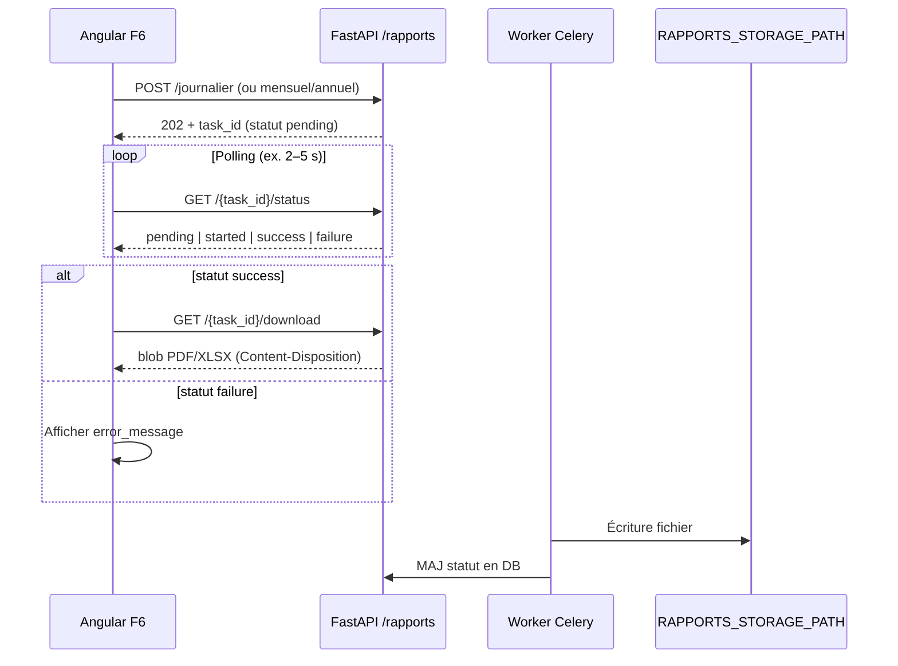

# Rapport d'intégration — Rapports CRSE (Sprint 6 · F6)

**Date :** 12 Juin 2026  
**Phase TODO :** Sprint 6 — phases 6.6, 6.1, 6.2, 6.3, 6.4, 6.5  
**Statut :** ✅ Backend validé (252 tests) · Frontend F6 **reporté** · Seed RBAC rapports ✅

---

## Vue d'ensemble

Le module rapports expose une API **asynchrone** : le client déclenche une génération (HTTP **202**), interroge le statut via `task_id`, puis télécharge le fichier une fois `success`. La génération réelle s'exécute dans Celery (`generer_rapport_task`).

**Prérequis runtime :** worker Celery actif, Redis, dossier `RAPPORTS_STORAGE_PATH` accessible en écriture.

---

## Contrats API vérifiés

| Endpoint | Méthode | Request | Response | HTTP | Statut backend |
|----------|---------|---------|----------|------|----------------|
| `/api/v1/rapports/journalier` | POST | Body JSON `RapportJournalierRequest` | `ApiResponse<RapportEnqueueResponse>` | 202 | ✅ |
| `/api/v1/rapports/mensuel/distribution` | POST | Query : `annee`, `mois`, `region_id?`, `limit`, `format` | `ApiResponse<RapportEnqueueResponse>` | 202 | ✅ |
| `/api/v1/rapports/mensuel/transport` | POST | Query : `annee`, `mois`, `limit`, `format` | `ApiResponse<RapportEnqueueResponse>` | 202 | ✅ |
| `/api/v1/rapports/annuel` | POST | Query : `annee`, `direction`, `region_id?`, `limit`, `format` | `ApiResponse<RapportEnqueueResponse>` | 202 | ✅ |
| `/api/v1/rapports/{task_id}/status` | GET | — | `ApiResponse<RapportStatusResponse>` | 200 | ✅ |
| `/api/v1/rapports/{task_id}/download` | GET | — | **Fichier binaire** (`FileResponse`) | 200 | ✅ |

**Enveloppe JSON** (tous les endpoints sauf download) :

```json
{"status": "success", "data": { ... }, "error": null}
```

**Frontend TS :** ✅ `RapportsService` + page `/rapports` (Vague 4)

---

## Schémas Pydantic ↔ interfaces TypeScript recommandées

### `RapportJournalierRequest` (body POST journalier)

| Champ JSON | Alias Pydantic | Type | Défaut | Notes |
|------------|----------------|------|--------|-------|
| `date` | `report_date` | `string` (ISO date `YYYY-MM-DD`) | jour courant | Optionnel |
| `region_id` | — | `number \| null` | `null` | Optionnel, ≥ 1 |
| `format` | `output_format` | `"pdf" \| "xlsx"` | `"pdf"` | |

```typescript
export interface RapportJournalierRequest {
  date?: string;           // ISO date YYYY-MM-DD
  region_id?: number | null;
  format?: 'pdf' | 'xlsx';
}
```

### `RapportEnqueueResponse` (réponse POST)

```typescript
export interface RapportEnqueueResponse {
  task_id: string;
  type_rapport: string;   // journalier | mensuel_distribution | mensuel_transport | annuel
  statut: string;         // pending au départ
  format: 'pdf' | 'xlsx';
}
```

### `RapportStatusResponse` (réponse GET status)

```typescript
export interface RapportStatusResponse {
  task_id: string;
  type_rapport: string;
  format: 'pdf' | 'xlsx';
  statut: 'pending' | 'started' | 'success' | 'failure';
  error_message: string | null;
  file_name: string | null;
  created_at: string;     // ISO datetime
  expires_at: string | null;
}
```

### Paramètres query (mensuel / annuel)

| Paramètre | Type | Contraintes | Défaut |
|-----------|------|-------------|--------|
| `annee` | int | 2000–2100 | requis |
| `mois` | int | 1–12 | requis (mensuel) |
| `region_id` | int | ≥ 1 | optionnel |
| `limit` | int | 1–50 | 10 (top feeders / équipements END) |
| `format` | string | `pdf` \| `xlsx` | `pdf` |
| `direction` | string | `distribution` \| `transport` \| `consolide` | `distribution` (annuel) |

**Convention frontend :** conserver **snake_case** dans les interfaces TS (aligné référentiel / interruptions).

---

## Flux async recommandé (F6)



**Implémentation Angular suggérée :**

1. `RapportService.enqueueJournalier(body)` → unwrap `data.task_id`
2. `RapportService.pollStatus(taskId)` — intervalle 2–5 s, arrêt sur `success` \| `failure`
3. `RapportService.download(taskId)` — `HttpClient` avec `responseType: 'blob'`, **sans** unwrap `ApiResponse` (réponse binaire directe)
4. Nom fichier : utiliser `file_name` du status ou header `Content-Disposition`

---

## RBAC

### Couche 1 — Permission API

Tous les endpoints exigent `require_permission("rapports", "read")`.

| Rôle | `rapports:read` dans seed RBAC | Rôle métier autorisé (service) |
|------|-------------------------------|--------------------------------|
| ADMIN_SAQS | ✅ | Distribution, transport, consolidé |
| ADMIN_SCR | ✅ | Distribution |
| ADMIN_DISPATCHING | ✅ | Transport |
| DISPATCHER | ✅ | Transport |
| BRC | ✅ | Distribution (région forcée) |
| BCC | ✅ | Distribution (service forcé) |
| SUPERVISEUR | ✅ | Distribution (service forcé) |

### Couche 2 — Règles métier (`rapport_generation_service`)

| Type rapport | Rôles autorisés |
|--------------|-----------------|
| Journalier | ADMIN_SAQS, ADMIN_SCR, BRC, BCC, SUPERVISEUR |
| Mensuel distribution | idem |
| Mensuel transport | DISPATCHER, ADMIN_DISPATCHING, ADMIN_SAQS |
| Annuel `direction=distribution` | rôles distribution |
| Annuel `direction=transport` | rôles transport |
| Annuel `direction=consolide` | **ADMIN_SAQS seul** |

### Périmètre géographique

| Rôle | `region_id` en requête |
|------|------------------------|
| ADMIN_SAQS, ADMIN_SCR, ADMIN_DISPATCHING, DISPATCHER | Libre (national) |
| BRC | Forcé à sa région (`scope_service_id`) ; filtre autre région → 403 |
| BCC, SUPERVISEUR | `region_id` interdit → 403 ; données limitées au service |

### Accès status / download

- Rôles nationaux (`ADMIN_SAQS`, `ADMIN_SCR`, `ADMIN_DISPATCHING`, `DISPATCHER`) : accès à tous les rapports.
- Autres rôles : uniquement les rapports qu'ils ont eux-mêmes générés (`record.user_id`).

---

## Codes HTTP et erreurs

| Code | Contexte | Message typique |
|------|----------|-----------------|
| 202 | POST enqueue OK | — |
| 200 | GET status OK / download OK | — |
| 401 | JWT absent / invalide | — |
| 403 | Permission ou rôle métier / périmètre / accès rapport | ex. « Rôle non autorisé pour les rapports transport » |
| 404 | `task_id` inconnu ou fichier absent | « Rapport introuvable » |
| 409 | Download alors que statut ≠ `success` | « Rapport non disponible (statut=…) » |
| 410 | Fichier expiré (TTL) | « Fichier expiré — relancez la génération » |
| 422 | Validation query/body | ex. `direction` invalide, `format` invalide |

Les erreurs FastAPI utilisent le même format que l'enveloppe API dans `detail` :

```json
{"status": "error", "data": null, "error": "Message lisible"}
```

---

## Configuration

| Variable | Défaut | Description |
|----------|--------|-------------|
| `RAPPORTS_STORAGE_PATH` | `./storage/rapports` | Répertoire fichiers générés |
| `RAPPORTS_FILE_TTL_HOURS` | `24` | Expiration téléchargement |
| `CELERY_BROKER_URL` | — | Requis pour génération async |
| `REDIS_URL` | — | Cache indicateurs dans rapports mensuels/annuels |

---

## Templates CRSE

Les exports PDF/Excel sont des **placeholders** (`# TODO(CRSE)` dans `rapport_export_*_service.py`). Validation SAQS requise avant mise en production visuelle.

---

## ✅ Points alignés (backend)

- Router enregistré sous `prefix="/rapports"` dans `app/api/v1/router.py`
- Génération **100 % asynchrone** — aucun PDF/XLSX synchrone dans les routers
- Transitions statut : `pending` → `started` → `success` | `failure`
- Tests intégration : `test_rapports_journalier.py`, `test_rapports_mensuel_*.py`, `test_rapports_annuel.py`, `test_rapports_status.py`
- Suite complète : **252 tests** verts

---

## ❌ Désalignements détectés

### DES-001 — Seed RBAC rapports distribution ✅ corrigé

- **Sévérité :** ~~Majeur~~ Résolu (Juin 2026)
- **Correction :** `rapports:read` ajouté à BCC, BRC, ADMIN_SCR, SUPERVISEUR dans `seed_rbac.py`
- **Action post-déploiement :** relancer `make seed-dev` ou `seed_rbac()` sur les environnements existants (idempotent)

### DES-002 — Module Angular F6 ✅ livré (Vague 4)

- **Frontend :** `RapportsService` (enqueue, poll, download blob) + `RapportsHubComponent` sur `/rapports`
- **Flux :** POST 202 → `pollStatus` (3 s) → download si `success`
- **RBAC UI :** types de rapport masqués selon rôle (distribution / transport / consolidé)

### DES-003 — GET download hors enveloppe `ApiResponse`

- **Sévérité :** Info
- **Backend :** `FileResponse` binaire (PDF `application/pdf`, XLSX `application/vnd.openxmlformats-officedocument.spreadsheetml.sheet`)
- **Frontend :** ne pas parser JSON sur `/download` ; utiliser `responseType: 'blob'`

---

## ⚠ Points à surveiller (F6)

- Alias JSON body journalier : envoyer `date` et `format`, pas `report_date` / `output_format`
- Polling : prévoir timeout UX (ex. 5 min) et affichage `error_message` si `failure`
- TTL 24 h : informer l'utilisateur si download retourne **410**
- Celery down : statut reste `pending`/`started` indéfiniment — message d'erreur côté UI
- Masquage UI par type rapport (transport vs distribution) doit refléter la matrice RBAC métier
- Comptes dev avec `rapports:read` : utiliser `admin.saqs` ou `dispatcher.dev` (après seed) ; BCC nécessite correction DES-001

---

## Tests manuels recommandés

1. Login ADMIN_SAQS → POST journalier PDF → poll status → download
2. Login DISPATCHER → POST mensuel transport → 202 ; POST mensuel distribution → 403 métier
3. Login ADMIN_SAQS → POST annuel `direction=consolide` → 202 ; login DISPATCHER → consolidé → 403
4. Attendre expiration TTL (ou modifier `expires_at` en DB) → download → 410
5. Tenter download sur statut `pending` → 409

**Script E2E :** `scripts/e2e_sprint6_rapports.ps1` (POST journalier → poll → download).

---

## Statut global

**✅ BACKEND + FRONTEND VALIDÉS** — Module F6 livré (Vague 4).

**Prochaines actions :**

1. QA : validation templates SAQS (checklist CRSE)
2. Environnements existants : relancer le seed RBAC si pas encore fait
